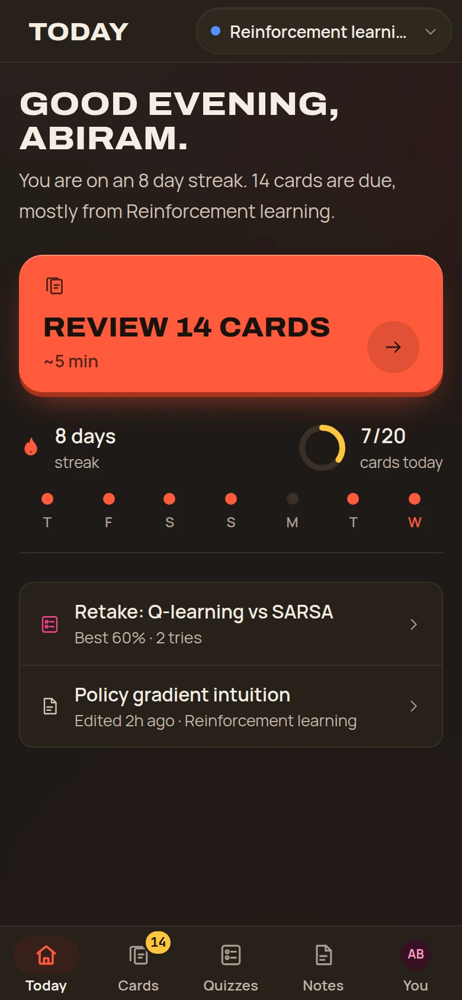
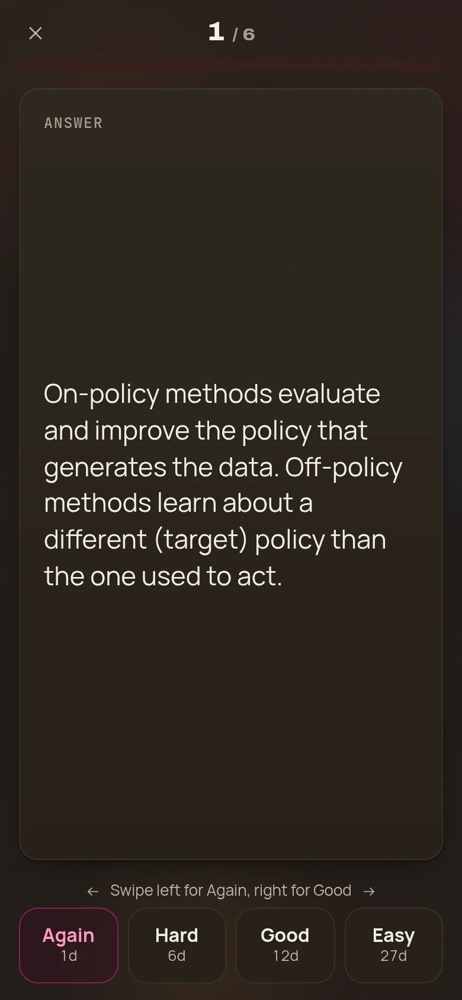
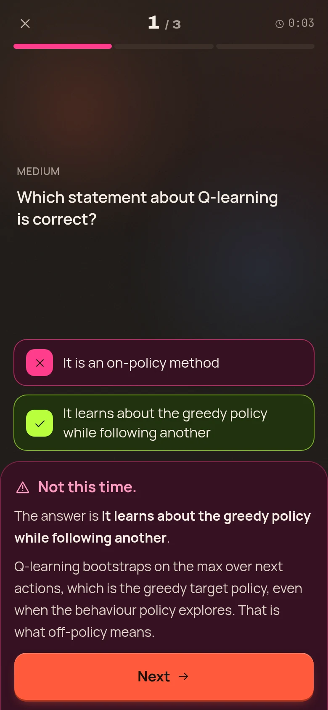
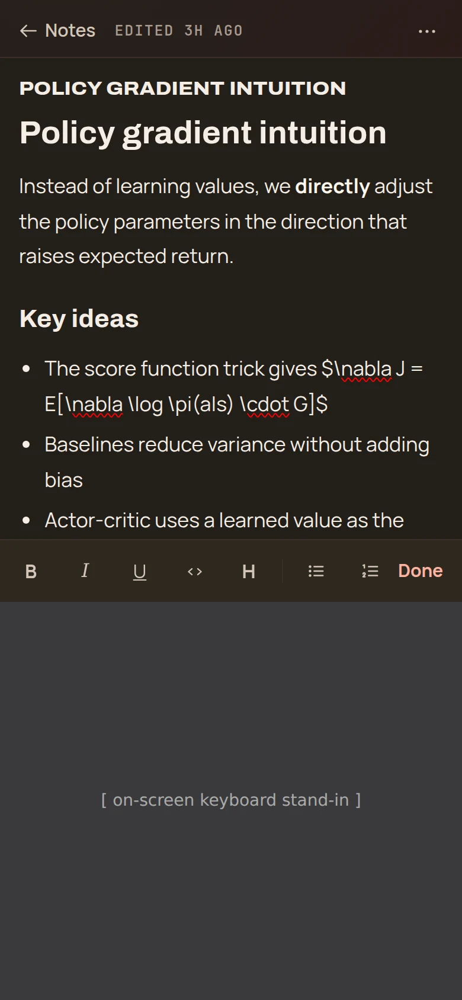
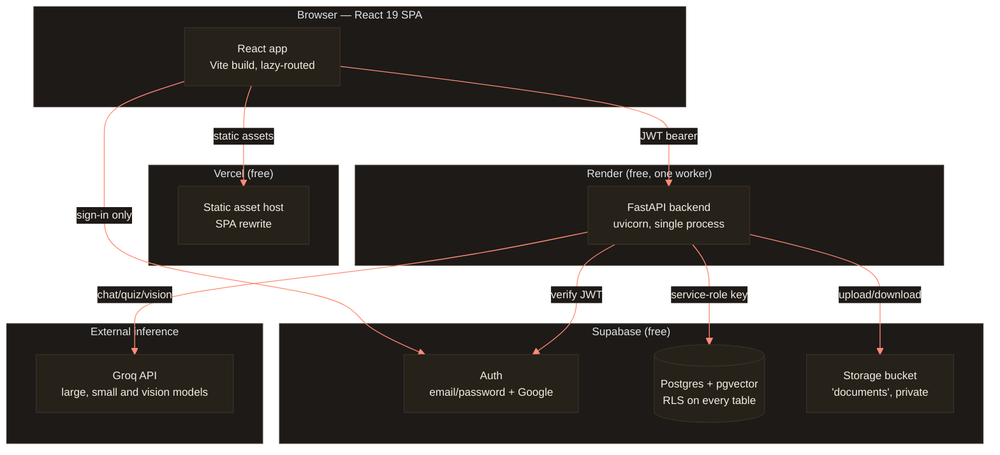

<div align="center">




**A study app for a student with a date.**
It answers only from your own notes and PDFs, shows the page each claim came from,
and turns answers into notes, flashcards and quizzes, shaped around what you are
preparing for and what you keep getting wrong.

[](https://space-learn.vercel.app)
[](LICENSE)
[](api/pyproject.toml)
[](web/package.json)
[](#run-it)

[Why](#why-it-is-different) · [What you can do](#what-you-can-do) · [How it works](#how-it-works) · [Personalisation](#personalisation-you-control) · [Free tier](#built-for-a-free-tier) · [Evaluation](#evaluation) · [Limitations](#known-limitations) · [Run it](#run-it)

</div>

## Why it is different

A general chatbot answers the question and forgets you. Space Learn is told what you
are preparing for (an end-semester paper, GATE, a placement interview), how many days
are left, what you keep getting wrong and how you like things explained, and it writes
the answers, the quiz questions and the daily plan for that.

| | |
|---|---|
| **Grounded** | Every answer cites the page it came from. A question your files don't cover is flagged, not guessed |
| **Personal** | A student model learns your weak topics from quizzes and card reviews and aims the next explanation at them |
| **In your control** | Pick the study mode and strictness, or switch personalisation off. Each answer says what it was personalised with, and only what it really used |
| **Honest** | One re-runnable [evaluation report](api/eval/REPORT.md), with the weak numbers next to the strong ones |
| **Free to run** | $0 infrastructure, designed around a measured limit of about 3 answers a minute for everyone |

## What you can do

- **Ask** over your own PDFs, notes and scans. A citation opens the exact passage.
- **Keep** any answer as a note (with live LaTeX) or a deck of flashcards.
- **Practise** with quizzes verified against their source, and FSRS-5 flashcards.
- **Study this note**: one click writes a quiz or cards from a single note of yours.
- **Plan**: a goal and a date give a countdown, a daily plan and a readiness number.
- **Steer** with study modes (exam, GATE, interview, learning) and your own Skills.



<table>
<tr>
<td align="center"><br /><sub>Today</sub></td>
<td align="center"><br /><sub>Card review</sub></td>
<td align="center"><br /><sub>Quiz</sub></td>
<td align="center"><br /><sub>Notes</sub></td>
</tr>
</table>

<sub>The phone has cards, quizzes and notes. Chat is on the desktop.</sub>

## How it works



The browser never talks to the database or the model. Every privileged operation goes
through the API, the only component that holds credentials. Its service-role key bypasses
row-level security, so ownership is enforced in code, and a test fails the build if a new
route skips the check.

### The RAG pipeline

One path per question. Each search-side stage stayed because removing it measurably hurt
([ablation](api/eval/ABLATION.md)).

| Stage | What it does | Why |
|---|---|---|
| **Read** | Reads headings and pages from a PDF's fonts and layout; scans go to a vision model | A citation can say "p. 4 · Satisfying 2NF", not "chunk 17" |
| **Isolate** | Parses each PDF in its own process with time and memory limits | A crafted PDF can fail its own upload, never the server |
| **Chunk** | Splits by structure: a chunk stays inside its section | Retrieved text is a coherent unit |
| **Embed** | BGE-small, run locally, stored at half precision | No embedding API, half the storage, identical scores |
| **Resolve** | Rewrites a follow-up ("which one?") into a standalone question | Follow-ups reaching the model fall from 83% to 56% without it |
| **Search** | Keyword and vector search in one SQL function, rank-fused | Without keyword search, exact-term hits fall from 92% to 80% |
| **Judge** | Decides whether the files cover the question; the unsure middle passes with a warning | Unsupported answers on uncovered questions fell from 12 of 14 to 0 of 13 |
| **Answer** | Streams the answer with `[[n]]` markers; citation cards arrive first | You see the sources while the answer is still arriving |
| **Verify** | Removes markers that point nowhere and moves ones on the wrong source | A marker that resolves to nothing is a broken promise |

Under each answer, **"Checked against your files"** scores every cited sentence against its
source (shared meaningful words, no model call) and names the one worth double-checking.

### Agents

| Agent | Workflow | What keeps it honest |
|---|---|---|
| **Quiz** | Plan coverage, write, check in code, verify each answer with a second model, repair a shortfall | Rejected questions are dropped; if the verifier fails the quiz ships marked as unchecked |
| **Flashcards** | Cards from sources spread over the file, each naming its passage | FSRS-5 in Python and TypeScript, held equal by a 504-case parity test |
| **Notes** | Writes a note from an answer, or edits inside one | Every note records whether a person, the AI or both touched it |
| **Skills** | Teaching styles you write, switched on per topic | Placed mid-prompt: they change how things are explained, never outrank the honesty rules |
| **Student model** | Weak concepts from quiz answers and reviews; style from a Thompson-sampling bandit | A concept needs three questions to count; observed habits are labelled as observed |

### Guardrails

- **Grounding.** With sources the model may only use them; without, it says so in one sentence.
- **Prompt order is the mechanism.** Style first, your Skill in the middle, honesty and safety rules last.
- **Untrusted input stays data.** Text in an image is content to describe, never an instruction.
- **Small blast radius.** Retrieval is scoped to one owner's topic; the model has no tools or network.
- **Ownership.** Foreign ids return 404, not 403, so existence isn't leaked.

## Personalisation you control

The student model already shaped answers. What was missing was letting the student see it,
steer it and switch it off.

- **Study mode.** College exam, GATE, interview prep or just learning. One short instruction
  per mode reaches chat, quizzes and cards. A closed set, so it cannot carry an injected instruction.
- **Goal and countdown.** A goal and a date give Home a plan for the days left, with no model call.
- **Readiness.** One number for "am I ready?", saying how many topics it rests on. An unmeasured
  topic is never scored zero.
- **"Made for you".** Under each answer: what it was personalised with, built from what the
  server really used.
- **My files only, or files plus subject knowledge.** Per topic, marked as such.
- **Make answers mine.** One switch: off, and no style, weak spot or misconception reaches the model.

## Built for a free tier

The model provider allows 8,000 tokens a minute and 200,000 a day per model, shared by every
student. Measured, that is **2.3–3.2 answers a minute and 58–79 a day**. The controls are sized against that.

| Control | What it does | Effect |
|---|---|---|
| Per-student allowance | 30 answers per rolling 24 hours (a quiz costs 2; failed and cached answers aren't charged) | One student can't spend everyone's day |
| Answer cache | Reuses an answer only for the same student, topic, sources and settings | A re-asked question costs no tokens |
| History budget | Newest answer kept nearly whole, older ones trimmed | 9,444 → 3,418 tokens in a 40-message chat |
| Model tiers | Large model for answers, quizzes and cards; small one for rewrites and checks | Separate allowance |
| Planned fallback | Chat moves to the small model at 90% of the large one's day | An answer instead of an error |

The limits and the student's own use of them are shown in Settings. Developer and tester accounts
can be exempted with `LLM_UNLIMITED_USER_IDS`.

## Evaluation

Everything comes from [`api/eval/REPORT.md`](api/eval/REPORT.md), rebuilt by `uv run python -m eval.report`.
The main benchmark is 114 questions (direct, reworded, follow-up, exact-term, cross-section, unanswerable)
over six Wikipedia PDFs, scored against quotes from the source so it needs no AI judge.

| Retrieval | Wikipedia | Student notes |
|---|---|---|
| Right passage ranked first | 69.4% | 81.2% |
| Evidence reached the model | **94.9%** (72% before the rebuild) | 96.9% |
| Uncovered question flagged as doubtful | 87.5% | 60.0% |

| Answers (36 graded) | Result |
|---|---|
| Correct | **91.7%** |
| Made an unsupported claim | 8.3% |
| Refused when the files don't cover it | 66.7% |
| Citations on the right passage | **87.5%** (28 of 32) |

Citations were 67.6% and refusals 50.0% at the first review. Ten of the twelve wrong markers were an
extra marker beside a correct one, because the prompt asked for "a second marker for safety"; changing
the prompt and counting a bracket style that had been missed raised it to 87.5%. The grader is a small
model and is noisy, so a plain wording check is reported beside it.

<details>
<summary><b>More results</b>: ablation, prompt and model choice, the grounding score</summary>

| Ablation: one stage removed | With | Without |
|---|---|---|
| Follow-up rewrite: follow-ups reaching the model | 83% | 56% |
| Keyword search: exact terms reaching the model | 92% | 80% |

| Arm (18 questions) | Correct | Unsupported | Citations right |
|---|---|---|---|
| Large model, original prompt | 88.9% | 5.6% | 71.4% |
| Large model, shorter prompt (shipped) | 88.9% | 5.6% | 94.1% |
| Small model, shorter prompt | 88.9% | 11.1% | 79.0% |

The "checked against your files" score, on 26 hand-labelled claims: 8 of 8 copied claims recognised,
10 of 10 invented or off-topic flagged, 2 of 2 wrong numbers flagged, 0 of 2 flipped meanings caught,
and all 4 faithful paraphrases flagged as "worth double-checking". It errs towards asking you to check.

</details>

## Decisions and their costs

<details>
<summary><b>What each choice gave up</b></summary>

| Decision | Why | Cost accepted |
|---|---|---|
| Local BGE-small, not a larger embedder | Fits a 512 MB host with no per-request cost | A lower retrieval ceiling |
| Hybrid search in one SQL function | One round trip, real Postgres ranking, measurable | Search logic lives in a migration |
| Guards in code, not row-level security | The API's key bypasses RLS, so RLS can't be the boundary | A missed check is silent, so a test enforces coverage |
| One worker, in-process limits and caches | The free host gives one process | Limits reset on deploy |
| Honesty rules last in the prompt | A Skill can't override grounding | The prompt prefix isn't cacheable |
| FSRS-5 in two languages | The review screen previews the next interval before the save lands | Two implementations, kept equal by a parity test |

**Tried, measured, rejected:** trimming passages to matching sentences (it lost the evidence on 2 of 98
questions) and using the small model for chat (twice the unsupported claims).

</details>

## Known limitations

- Refusing questions the files do not cover is the weakest number: 66.7% on the sample, 60% on student notes.
- The graded sample is small (one citation marker is about 3 points) and the grader is a noisy small model.
- The main benchmark is six Wikipedia articles; the second set is short student-style notes we wrote, not
  real lecture notes or scans.
- Notes and one quiz topic are not evaluated, and the study modes, countdown and readiness number are not
  measured by the harness. Readiness is a transparent estimate, not a prediction of an exam mark.
- No load testing of the deployed service, no monitoring beyond logs, and no user study.
- The grounding score is lexical: it misses flipped meanings and flags faithful paraphrases.
- Web search is deliberately absent: the free tier is too tight, and it would weaken the guarantee that
  answers come from your own files.
- Rate limits and caches are in memory: per process, reset on deploy. Chat is desktop-only.

## Run it

[](https://vercel.com/new/clone?repository-url=https%3A%2F%2Fgithub.com%2FAbiram116%2FNew-Space-Learn&root-directory=web&project-name=space-learn)
[](https://render.com/deploy?repo=https://github.com/Abiram116/New-Space-Learn)

You need Node.js (LTS), Python 3.11–3.12, a free [Supabase](https://supabase.com) project and a free
[Groq](https://console.groq.com) key:

```bash
git clone https://github.com/Abiram116/New-Space-Learn.git
cd New-Space-Learn
cp .env.example .env       # fill in the Supabase and Groq keys
npm run db:push            # apply the database migrations
npm run dev                # backend and frontend together
```

[`docs/operations/setup.md`](docs/operations/setup.md) has the full walkthrough. Apply migrations that add
something before a deploy and ones that remove something after it: a migration that dropped a function the
live API still called once took chat down.

```bash
cd web && npm test                              # 1,683 frontend tests
cd api && uv run --extra dev pytest             # 1,143 backend tests
cd api && uv run python -m eval.report --free   # prompt size, caches, capacity (no model calls)
```

## Repo

```
web/         React 19, TypeScript, Vite, Tailwind        → Vercel
api/         FastAPI and the AI pipeline                  → Render
api/eval/    benchmark, evaluation scripts, REPORT.md
supabase/    Postgres + pgvector migrations
docs/        architecture, decisions, setup
```

| | |
|---|---|
| **AI** | Groq (`gpt-oss-120b`, `gpt-oss-20b`, a vision model), local BGE-small via `fastembed` |
| **Backend** | FastAPI (async, one worker), Pydantic v2, `httpx` |
| **Data** | Supabase: Postgres + pgvector, Auth, Storage |
| **Frontend** | React 19, TypeScript, Vite, Tailwind CSS v4, Tiptap, KaTeX |

More depth: [architecture](docs/engineering/architecture.md) · [AI pipeline](docs/engineering/ai-pipeline.md) ·
[personalisation](docs/engineering/personalization.md) · [security](docs/engineering/security.md) ·
[decisions](docs/decisions.md) · [evaluation](api/eval/REPORT.md).

Before a PR: tests pass, `npm run build` succeeds, `ruff` and `oxlint` are clean, and any route taking a
caller-supplied id proves ownership.

## Built by

Abiram and Nandhitha (KLEF, Hyderabad, Dept. of Artificial Intelligence and Data Science), as a capstone project.

## License

MIT, see [LICENSE](LICENSE).
