<div align="center">



# Space Learn

**A study app for a student with a date.**
It answers only from your own notes and PDFs, shows the page each claim came from,
and shapes everything around what you are preparing for and what you keep getting wrong.

[](https://space-learn.vercel.app)
[](LICENSE)
[](api/pyproject.toml)
[](web/package.json)

[Why](#why-it-is-different) · [What you can do](#what-you-can-do) · [The numbers](#the-numbers) · [Free tier](#built-for-a-free-tier) · [Run it](#run-it) · [Deep dive](docs/engineering/deep-dive.md)

</div>

## Why it is different

A general chatbot answers the question and forgets you. Space Learn is told what you
are preparing for (an end-semester paper, GATE, a placement interview), how many days
are left, what you keep getting wrong and how you like things explained. Then it writes
the answers, the quiz questions and the daily plan for that.

- **Grounded.** Answers come from your files and cite the page. A question your files
  don't cover is flagged, not guessed.
- **Personal.** A student model learns your weak topics from quizzes and card reviews,
  and the next explanation aims at them.
- **Controllable.** You pick the mode, the strictness and whether any of it applies.
  Every answer says what it was personalised with, and only what it really used.

## What you can do

| | |
|---|---|
| **Ask** | Chat over your own PDFs, notes and scans. Citations open the exact passage |
| **Keep** | Turn any answer into a note, with live LaTeX, or a deck of flashcards |
| **Practise** | Quizzes checked against their source, and flashcards scheduled with FSRS-5 |
| **Study this note** | One click writes a quiz or cards from a single note of yours |
| **Plan** | A goal and a date give you a countdown, a daily plan and a readiness number |
| **Steer** | Study modes (exam, GATE, interview, just learning), your own Skills, and a "make answers mine" switch |



<details>
<summary><b>What it looks like</b></summary>



<sub>A mockup in the app's own design system, not a screenshot.</sub>

</details>

## The numbers

Measured, re-runnable with one command, and kept in
[one report](api/eval/REPORT.md). Including the ones that are not flattering.

| | |
|---|---|
| **94.9%** | of benchmark questions had the evidence reach the model (72% before the retrieval rebuild) |
| **91.7%** | of answers judged correct on a graded sample |
| **87.5%** | of citations point at the passage that holds the evidence |
| **66.7%** | refusals on questions the files don't cover. The weakest number, and said so |
| **$0** | infrastructure. The free tier serves about 3 answers a minute, and the system is built around that |

Small samples, one benchmark of six Wikipedia articles plus a second set of
student-style notes. [Known limitations](docs/engineering/deep-dive.md#known-limitations)
lists what is not measured.

## How it stays honest

Guards live in code, not in the prompt. Every route that takes an id proves the caller
owns it, and a test sweeps all of them. PDFs are parsed in a separate process with time
and memory limits. Citations are repaired after the stream: ones that point nowhere are
removed, ones on the wrong source are moved. Each cited sentence is scored against its
source and the answer shows "2 of 3 claims found in your files".

## Built for a free tier

One student can't spend everyone's allowance: 30 answers in a rolling 24 hours, a short
burst then about 4 a minute, and a cache that never replays an answer across students,
topics or settings. When the large model's day is nearly spent, chat moves to the small
one on purpose instead of failing. The limits are shown in Settings with today's use.

## Stack

| | |
|---|---|
| **AI** | Groq (`gpt-oss-120b`, `gpt-oss-20b`, a vision model), local BGE-small embeddings |
| **Backend** | FastAPI (async), Pydantic v2, `httpx` |
| **Data** | Supabase: Postgres + pgvector, Auth, Storage |
| **Frontend** | React 19, TypeScript, Vite, Tailwind CSS v4, Tiptap, KaTeX |
| **Proof** | 1,143 backend and 1,683 frontend tests |

## Run it

[](https://vercel.com/new/clone?repository-url=https%3A%2F%2Fgithub.com%2FAbiram116%2FNew-Space-Learn&root-directory=web&project-name=space-learn)
[](https://render.com/deploy?repo=https://github.com/Abiram116/New-Space-Learn)

You need Node.js (LTS), Python 3.11–3.12, a free [Supabase](https://supabase.com) project
and a free [Groq](https://console.groq.com) key:

```bash
git clone https://github.com/Abiram116/New-Space-Learn.git
cd New-Space-Learn
cp .env.example .env       # fill in the Supabase and Groq keys
npm run db:push            # apply the database migrations
npm run dev                # backend and frontend together
```

[`docs/operations/setup.md`](docs/operations/setup.md) has the full walkthrough.

```bash
cd web && npm test                     # frontend tests
cd api && uv run --extra dev pytest    # backend tests
cd api && uv run python -m eval.report --free   # prompt size, caches, capacity (no model calls)
```

## Go deeper

[Deep dive](docs/engineering/deep-dive.md) (the pipeline, agents, evaluation tables and
every decision with its cost) ·
[architecture](docs/engineering/architecture.md) ·
[AI pipeline](docs/engineering/ai-pipeline.md) ·
[personalisation](docs/engineering/personalization.md) ·
[security](docs/engineering/security.md) ·
[decisions](docs/decisions.md) ·
[evaluation report](api/eval/REPORT.md)

Chat is desktop-only for now. Phones get notes, flashcards and quizzes.

## License

MIT, see [LICENSE](LICENSE).
