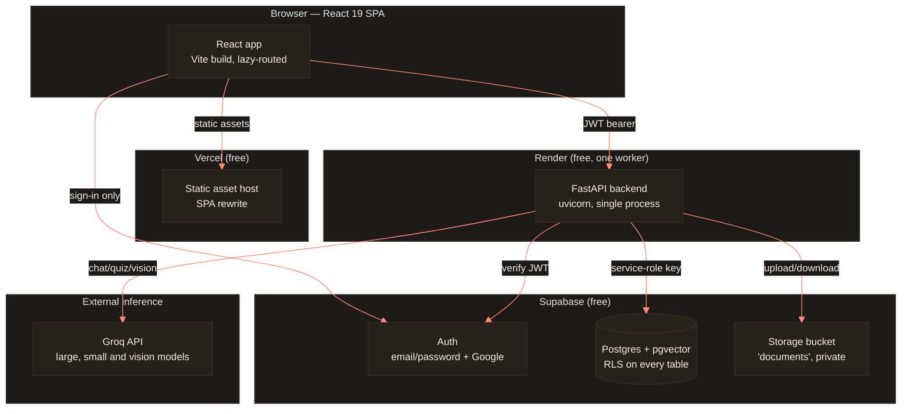

<div align="center">


**A study app for a student with a date. It answers only from your own documents,
shows the page each claim came from, and turns answers into notes, flashcards and
quizzes, shaped around what you are preparing for and what you keep getting wrong.**

[](https://space-learn.vercel.app)
[](LICENSE)
[](api/pyproject.toml)
[](web/package.json)

[Who it is for](#who-it-is-for) · [RAG pipeline](#the-rag-pipeline) · [Agents](#agents) · [Personalisation](#personalisation-and-the-controls-over-it) · [Free tier](#operating-inside-a-free-tier) · [Evaluation](#evaluation) · [Decisions](#decisions-and-their-costs) · [Limitations](#known-limitations) · [Run it](#run-it)

</div>

## At a glance

| | |
|---|---|
| **What** | Retrieval-augmented chat over a student's own PDFs, notes and scans, plus agents that write quizzes, flashcards and notes from it |
| **Retrieval** | Layout-aware chunking, local BGE-small embeddings, vector + keyword search fused in one SQL call. The evidence reaches the model on **94.9%** of benchmark questions |
| **Answers** | **91.7%** judged correct on a graded sample, **87.5%** of citations pointing at the passage that holds the evidence. The weakest number is refusing questions the files don't cover (66.7%) |
| **Agents** | Quiz (plan, write, check, verify), flashcards (FSRS-5 scheduling), notes, user-written Skills, and a student model that feeds results back |
| **Cost** | $0 infrastructure. The free model tier serves the whole app about 3 answers a minute, and the system is built around that limit |
| **Proof** | [One re-runnable evaluation report](api/eval/REPORT.md), 1,143 backend and 1,683 frontend tests |

This is an AI engineering project first. The interesting work is in retrieval,
grounding, agent workflows, guardrails and measuring whether any of it works.
What it does badly is written down next to what it does well.

## Who it is for

A student with a date: an end-semester paper, GATE, a placement interview. The weeks
before something that matters, with a pile of their own slides and notes and not
enough time. A general chatbot answers the question and forgets the student. This one
is told what the student is preparing for, how many days are left, what they keep
getting wrong and how they like things explained, and it writes everything (answers,
quiz questions, the daily plan) for that.

Students put their own material into Subjects and Topics, then ask questions. The model
answers only from those files and marks each claim with its page. Any answer, or any
single note, can become a note, a deck of flashcards or a quiz, and the results feed a
student model that shapes the next explanation.


<details>
<summary><b>What it looks like</b></summary>


<sub>A mockup in the app's own design system, not a screenshot.</sub>

</details>

## Architecture




The browser never talks to the database or the model. Every privileged operation goes
through the API, the only component holding credentials. Its service-role key bypasses
row-level security, so ownership is enforced in code, and a test fails the build if a
new route skips the check. Citations are computed **before** the model call and streamed
first, so source cards appear while the answer is still arriving.

## The RAG pipeline

One path per question. The search-side stages were each kept because removing them
measurably hurt ([ablation](api/eval/ABLATION.md)).

| Stage | What it does | Why |
|---|---|---|
| **Read** | Reads headings and pages from a PDF's fonts and layout. Scanned pages go to a vision model | A citation can say "p. 4 · Satisfying 2NF" instead of "chunk 17" |
| **Isolate** | Parses each PDF in a separate process with time and memory limits | A crafted PDF can fail its own upload, never the server |
| **Chunk** | Splits by structure; a chunk stays inside its section | Retrieved text is a coherent unit |
| **Embed** | BGE-small, run locally, stored at half precision (`halfvec`) | No embedding API, half the storage, identical benchmark scores |
| **Resolve** | Rewrites a follow-up ("which one?") into a standalone question | Follow-ups reaching the model fall from 83% to 56% without it |
| **Search** | Vector and keyword search in one SQL function, rank-fused | Without keyword search, exact-term hits fall from 92% to 80% |
| **Judge** | Decides whether the documents cover the question; unsure matches pass with a warning | Unsupported answers on uncovered questions fell from 12 of 14 to 0 of 13 |
| **Answer** | Streams the answer with `[[n]]` markers; citation cards go first | The student sees the sources while the answer arrives |
| **Verify** | After the stream: strips markers that point nowhere, moves ones on the wrong source | A marker that resolves to nothing is a broken promise |

Clicking a citation opens the cited passage with the text highlighted. Pipeline code is
in `api/app/services/`.


## Agents

| Agent | Workflow | What keeps it honest |
|---|---|---|
| **Quiz** | Plan coverage, write, check for repeats and malformed items, verify each answer against its source with a second model | Rejected questions are dropped; if the verifier fails, questions ship marked as unchecked |
| **Flashcards** | Written from sources spread over the file, each card naming its passage | FSRS-5 scheduling in Python and TypeScript, held together by a 504-case parity test |
| **Notes** | Writes a note from an answer, or edits inside a note on request | Every note records whether a person, the AI, or both have touched it |
| **Skills** | Teaching styles a student writes, switched on per topic | Placed mid-prompt: a Skill can change how things are explained, never outrank the honesty rules |
| **Student model** | Weak topics and concepts derived from quiz answers and reviews | A concept needs three questions before it counts; observed habits are labelled as observed |

## Guardrails and trust boundaries

- **Grounding.** With sources, the model may only use them; without, it says so in one sentence.
- **Prompt order is the mechanism.** Style rules first, a Skill in the middle, honesty and
  safety rules last, because the last constraint reads as the most specific.
- **Untrusted input stays data.** Text inside an uploaded image is content to describe,
  never an instruction. SVG is refused because it can carry script.
- **Small blast radius.** Retrieval is scoped to one owner's topic and the model has no
  tools, shell or network: an injected instruction can change what is said, not what is done.
- **Ownership.** Foreign ids return 404, not 403, so existence isn't leaked.
- **Narrow safety rules.** Only operational harm is refused; an over-refusing tutor is a worse product.
- **Scope is stated.** Each answer says whether it was held to the student's files or allowed
  general knowledge, with a lower temperature (0.2) when answering from files.

## Personalisation, and the controls over it

- **Study mode.** College exam, GATE, interview prep or just learning. One short
  instruction per mode reaches chat, quizzes and cards. A closed set, not free text, so it
  can't carry an injected instruction; a mode change also changes the answer-cache key.
- **Goal and countdown.** A goal and a date give Home a plan for the days left, with no model call.
- **Readiness.** One number for "am I ready?", with how many topics it is based on
  ("from 4 of 6"). An unmeasured topic is never scored as zero.
- **"Made for you" under each answer.** Rendered from what the server actually used for
  that turn. A fact that was not used is not claimed.
- **Checked against your files.** Each cited sentence is scored against its source, and the
  answer shows "2 of 3 claims found in them". It says "worth double-checking", never "wrong".
- **Make answers mine.** One switch. Off, no style, weak spot or misconception reaches the model.
- **Study this note.** One click writes a quiz or cards from a single note.
- **My files only / Files + subject.** Per topic: strictly your files, or your files first and
  general knowledge of the subject, marked as such.

## Operating inside a free tier

The model provider allows 8,000 tokens a minute and 200,000 a day per model, shared by
every student. Measured, that is **2.3–3.2 answers a minute and 58–79 a day**.

| Control | What it does | Effect |
|---|---|---|
| Per-student allowance | 30 answers in a rolling 24 hours; failed and cached answers aren't charged | One student can't spend everyone's day |
| Answer cache | Reuses an answer only for the same student, topic, sources and settings | A re-asked question costs no tokens |
| History budget | Newest answer kept nearly whole, older ones trimmed | 9,444 → 3,418 tokens in a 40-message chat |
| Model tiers | Large model for answers, quizzes and cards; small one for rewrites and verification | The small model's allowance is separate |
| Planned degradation | Chat moves to the small model at 90% of the large one's day | An answer instead of an error |

Limits are shown to the student with their own usage in Settings (`GET /me/limits`): a burst
of 6 then about 4 a minute, 20 MB per file, up to 1,200 passages per text file, the first 12
pages of a scan, and 4,000 characters and 3 images per message. When the model is busy, the
chat keeps the question and offers cards and notes, which need no model.

## Evaluation

Everything below comes from [`api/eval/REPORT.md`](api/eval/REPORT.md), rebuilt by
`uv run python -m eval.report`. The main benchmark is 114 questions (direct, reworded,
follow-up, exact-term, cross-section and unanswerable) over six Wikipedia PDFs, searched
through the production SQL function on a local PostgreSQL with pgvector, scored against
quotes from the source so results don't depend on how documents are chunked.

| Retrieval | Result |
|---|---|
| Right passage ranked first | 69.4% |
| Right passage in the top five | 90.8% |
| Evidence reached the model | 94.9% (72% before the retrieval rebuild) |
| All parts of a multi-part answer reached it | 92.9% |

| Answers (36-question sample, graded by a second model) | Result |
|---|---|
| Correct | 91.7% |
| Made an unsupported claim | 8.3% |
| Refused when the documents don't cover the question | 66.7% |
| Citations pointing at the right passage | 87.5% (28 of 32 markers) |

Citations were 67.6% before a prompt change and marker normalisation (7 November re-grade);
refusals were 50.0%. A further repair step, `tighten_citations`, takes the sample to 29 of 30
offline but is **in-sample**: on answers it had not seen it changed nothing, so it is shipped
as safe, not as proven to help.

**Student notes** (37 questions over three sets of messy revision notes: shorthand, worked numbers)

| Measure | Student notes | Wikipedia |
|---|---|---|
| Right passage ranked first | 81.2% | 69.4% |
| Evidence reached the model | 96.9% | 94.9% |
| Uncovered question flagged as doubtful | 60.0% (3 of 5) | 87.5% |
| Covered question wrongly flagged | 28.1% | 9.2% |
| Answers judged correct (12 graded) | 91.7% | 91.7% |

Finding passages in shorthand works at least as well as in clean prose. Knowing when the notes
do *not* answer is worse: the thresholds were set on Wikipedia, and short overlapping notes leave
less daylight between "covered" and "not covered". The set is small and written for this project,
so treat it as a second opinion.

**Why it is not better.** The ceiling is retrieval: 5 of 98 answerable questions never get their
evidence to the model. Of the 4 wrong citations in 32, three are an extra marker beside a right one
and one is a tie that word overlap can't settle. The judge is a small model and is noisy: a plain
wording check disagrees with it on 3 of 36 answers, so the headline stays the judge's figure and
the wording check is reported beside it. One sample, one marker is about three points.

**The "checked against your files" score** (26 hand-labelled claims, `uv run python -m eval.grounding`)

| Claim type | Result |
|---|---|
| Copied or lightly reworded (8) | 8 of 8 recognised as backed |
| Invented detail (6) and off-topic (4) | 10 of 10 flagged, never ticked |
| Wrong number in an otherwise matching sentence (2) | 2 of 2 flagged |
| Flipped verb or negation (2) | 0 of 2 caught |
| Faithful paraphrase in different words (4) | 0 of 4 recognised: all flagged "worth double-checking" |

A tick means something (precision of "backed" is 80% here). It errs toward asking the student to
check, not toward reassurance, but it can't see a flipped meaning.

<details>
<summary><b>More results</b>: prompt and model comparison, agents, system</summary>

| Arm (18 questions each) | Correct | Unsupported | Citations right |
|---|---|---|---|
| Large model, original prompt | 88.9% | 5.6% | 71.4% |
| Large model, shorter prompt (shipped) | 88.9% | 5.6% | 94.1% |
| Small model, shorter prompt | 88.9% | 11.1% | 79.0% |

The shorter prompt cost nothing in correctness, so it shipped. The small model doubled the
unsupported claims, so chat stays on the large one.

| Agents and system | Result |
|---|---|
| Flashcards (3 topics, 8 cards each) | 24 of 24 kept and sourced, 0 repeats, 23 of 24 phrased as questions |
| Quiz questions, graded by an independent model | 5 of 5 sound on two topics; the third is incomplete |
| Prompt, plain question / one needing structure | about 2,200 / 2,600 tokens with six sources |
| Answer cache | 8 of 8 cases correct: never another student, topic, source set or setting |
| Small model, time to first word | about 0.9 s. The large model's live latency is not measured yet |

</details>

## Decisions and their costs

<details>
<summary><b>The decisions</b></summary>

| Decision | Why | Cost accepted |
|---|---|---|
| Local BGE-small, not a larger or hosted embedder | Fits a 512 MB host with no per-request cost | A lower retrieval ceiling |
| Hybrid search in one SQL function | One round trip, real Postgres ranking, measurable | Search logic lives in a migration |
| Guards in code, not row-level security | The API's key bypasses RLS, so RLS can't be the boundary | A missed check is silent, so a test enforces coverage |
| One worker, in-process limits and caches | The free host gives one process | Limits reset on deploy and don't span instances |
| Honesty rules last in the prompt | A user's Skill can't override grounding | The prompt prefix isn't cacheable |
| FSRS-5 in two languages | The review screen previews the next interval before the save lands | Two implementations, kept equal by a parity test |

**Tried, measured, rejected:** trimming passages to matching sentences (it lost the evidence on 2 of
98 questions); the small model for chat (twice the unsupported claims); a stored concept graph.

</details>

<details>
<summary><b>When things fail</b></summary>

| Failure | What happens |
|---|---|
| The large model is rate-limited or down | Retries before the first token only, then falls back to the small model |
| The large model's day is nearly spent | Chat goes to the small model deliberately |
| Retrieval finds nothing relevant | The model is told to say the material doesn't cover it |
| A PDF hangs or balloons the parser | Its process is killed; only that upload fails, with a retry button |
| A citation points at nothing | It is removed before the answer is stored |
| A student exceeds their allowance | A plain message says when the next answer frees up |
| The host is cold | The first request waits roughly 30 to 60 seconds (not measured) |

</details>

## Known limitations

- Citation precision is 87.5% and refusals on uncovered questions are 66.7%, on a 36-answer
  sample (small: one marker moves precision by about 3 points).
- Flagging "the files don't cover this" is weaker on small, overlapping material (60% on the student
  notes against 87.5% on Wikipedia).
- The main benchmark is six Wikipedia articles; the second set is short student-style notes written
  for this project, not real lecture notes or scans.
- Notes are not evaluated, and the quiz evaluation is incomplete on one topic.
- No load testing against the deployed service, and no monitoring beyond logs.
- The "checked against your files" score is lexical: it misses flipped meanings and flags faithful
  paraphrases. Readiness is a transparent estimate, not a validated prediction of an exam score.
- Web search is deliberately absent: the free model tier is too tight, and a web answer would weaken
  the guarantee that answers come from the student's own files.
- Rate limits and caches are in memory: per process, reset on deploy.
- Chat is desktop-only. Phones get notes, flashcards and quizzes.

<div align="center">

</div>

## Run it

[](https://vercel.com/new/clone?repository-url=https%3A%2F%2Fgithub.com%2FAbiram116%2FNew-Space-Learn&root-directory=web&project-name=space-learn)
[](https://render.com/deploy?repo=https://github.com/Abiram116/New-Space-Learn)

Locally you need Node.js (LTS), Python 3.11–3.12, a free [Supabase](https://supabase.com) project
and a free [Groq](https://console.groq.com) key:

```bash
git clone https://github.com/Abiram116/New-Space-Learn.git
cd New-Space-Learn
cp .env.example .env       # fill in the Supabase and Groq keys
npm run db:push            # apply the database migrations
npm run dev                # backend and frontend together
```

[`docs/operations/setup.md`](docs/operations/setup.md) has the full walkthrough. Apply additive
migrations before a deploy and anything that removes something after it: a migration that dropped a
function the live API still called once took chat down.

```bash
cd web && npm test                     # 1,683 frontend tests
cd api && uv run --extra dev pytest    # 1,143 backend tests
cd api && uv run python -m eval.report --free   # prompt size, caches, capacity (no model calls)
```

## Repo

```
web/         React 19, TypeScript, Vite, Tailwind    → Vercel
api/         FastAPI and the AI pipeline              → Render
api/eval/    benchmark, evaluation scripts, REPORT.md
supabase/    Postgres + pgvector migrations
docs/        architecture, decisions, setup
```

| | |
|---|---|
| **AI** | Groq (`gpt-oss-120b`, `gpt-oss-20b`, a vision model), local BGE-small via `fastembed` |
| **Backend** | FastAPI (async, one worker), Pydantic v2, `httpx` |
| **Data** | Supabase: Postgres + pgvector, Auth, Storage |
| **Frontend** | React 19, TypeScript, Vite, Tailwind CSS v4, Tiptap, KaTeX |

More depth: [architecture](docs/engineering/architecture.md) ·
[AI pipeline](docs/engineering/ai-pipeline.md) ·
[personalization](docs/engineering/personalization.md) ·
[security](docs/engineering/security.md) ·
[decisions](docs/decisions.md) ·
[evaluation](api/eval/REPORT.md).

Before a PR: tests pass, `npm run build` succeeds, `ruff` and `oxlint` are clean, and any route
taking a caller-supplied id proves ownership.

## License

MIT, see [LICENSE](LICENSE).
